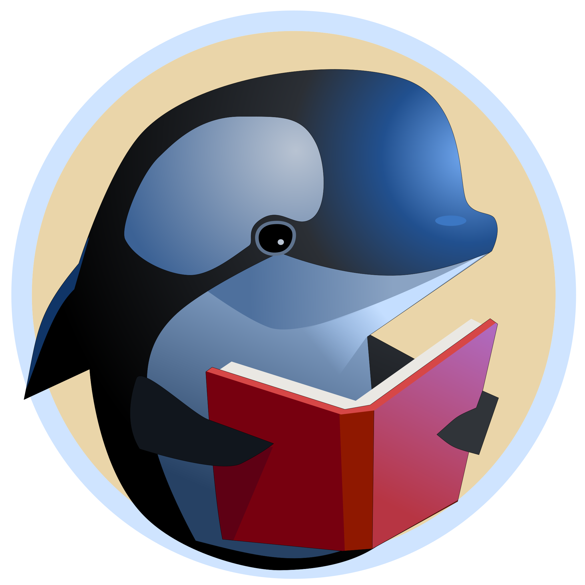

# ORCA


[](https://github.com/kolja/orca/actions)
[](https://coveralls.io/github/kolja/orca?branch=main)
[](https://deps.rs/repo/github/kolja/orca?path=%2F)
[](https://opensource.org/licenses/MIT)

A simple OPDS Server for Calibre written in Rust.

It supports:

- OPDS v1 and v2
- http and https
- basic authentication
- multiple Calibre libraries

## Try it

Before you serve your own library, you can test orca by firing up a demo that contains
seven public-domain books, in three languages, as EPUB, MOBI and AZW3:
```bash
docker run --rm --pull=always -p 23117:23117 koljaw/orca-demo
```
Add `--auth` at the end to serve the same library behind a login (`alice` / `secretpassword`)
then point an OPDS reader at `http://127.0.0.1:23117/v1` (or `http://127.0.0.1:23117/v2` for OPDS v2)

## Installation

### Homebrew
```bash
brew tap kolja/orca
brew install orca-server
```
### Docker
```bash
docker pull koljaw/orca
docker run -p 8080:8080 \
-e ORCA_CONFIG=/app/orca.toml \
-v /path/to/your/config.toml:/app/orca.toml \
-v /path/to/your/library:/app/library \
koljaw/orca:latest
```

## Configuration

If you point the environment variable `ORCA_CONFIG` to a `.toml` file, that's where the configuration will be read from. Otherwise, it will look for a file named `orca.toml` or `orca/config.toml` in `$HOME/.config/`.

The server will either start as HTTP or HTTPS server depending on the value of `protocol`. If you set it to `https`, you have to provide a path to a certificate and a key file.
```toml
[server]
ip = "<your_ip>"
port = 8080
protocol = "https" # or "http"
cert = "/path/to/cert.pem"
key = "/path/to/key.pem"
public_url = "https://orca.example.com" # optional, see below

[authentication.login]
alice = "$argon2id$v=19$m=19456,t=2,p=1$bK0qYfzAokhthFP0fKBQvg$QPPf54SN74dT2YX4aGoN+KxoWD+xV+c6OBrrPnvxj24"
bob = "$argon2id$v=19$m=19456,t=2,p=1$FMnONzRzIAkaIuy3c+A9cg$DE3+UC62d/f+L0jqEWgz9GAfNWQkKfugeZFSL/FG5XQ"

[authentication]
public = ["/", "/library"] # the catalog and the whole `library` need no login

[catalog]
author = "Jorge Luis Borges" # optional (default: "orca")
landing_page = "landing-page.toml" # optional

[calibre.libraries.library]
path = "/Volumes/library"

[calibre.libraries.nonfiction]
path = "/Volumes/nonfiction"
author = "Isaac Newton" # optional (overrides catalog.author)
landing_page = "nonfiction.toml" # optional (overrides catalog.landing_page)
```
## The landing page

Out of the box, the landing page lists the following sections:
`books` (All Books), `new` (Recently Added), `authors`, `tags`, `series` and `publishers`.

You can override this by pointing `landing_page` at your own toml file to say which of them you want and in which order.
The path should be relative to the directory your `orca.toml` is located.
```toml
[[section]]
type = "books"

[[section]]
type = "tags"
title = "Genres" # optional: You can rename what the section should be called.

[[section]]
type = "new"
```

`type` is the only key a section needs, you can supply a `title` if you would like to rename a section.

## Authentication

The server supports basic authentication: You can generate a password hash like so:
```bash
orca --hash <login>:<password> # e.g. orca --hash alice:secretpassword
```
The server will print the hash which you have to copy to the `[authentication.login]` section of your config file.

Omit the `[authentication]` section if you want everything to be public (orca will not ask for credetials).

With the section present, all libraries require authentication except for those listed in the `public` array.

| entry | opens |
| --- | --- |
| `/` | the catalog — the list of libraries |
| `/library` | library in both formats (OPDS v1 and v2) |
| `/v1/library` | Atom only (`/v2/library` for JSON) |

A catalog lists only the libraries the caller can actually open, so a client that logs in may see more than a guest does. Note that making a library public does not by itself make it discoverable: name `/` too, or point clients straight at `/v1/library`.

## Who publishes the catalog

According to RFC 4287 every catalog needs an Author. The field is set to "orca" by default, but you can override it for the entire catalog or set it individually per library.

## Running behind a reverse proxy

Every feed advertises its own address in `<link rel="self">`.
Some OPDS clients will resolve links against that self link instead of against the URL they fetched — which is not necessarily the address Orca binds to.

Orca derives it from the request, honouring `X-Forwarded-Proto` and `X-Forwarded-Host`, so a proxy that sets those headers needs no extra configuration.

If your proxy cannot set them, set `public_url` in the `[server]` section to the
externally visible base URL. It will take precedence over the headers.

## Development

There are a couple of tasks you can run with `cargo make`:

- `cargo make docker-build <image/name>` - Build Docker image and push it to the registry, followed by `<image/name>-demo`
- `cargo make docker-build-demo <image/name>` - Rebuild only the demo image
- `cargo make git-tag` - Create and push a new git tag. The Version number is read from `Cargo.toml`
- `cargo make list-sha` - List all the sha256 hashes for the Assets in the Release (for use with the the homebrew formula)

## License

MIT
